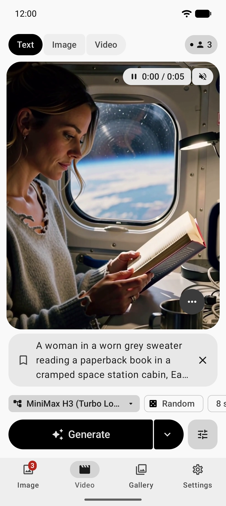
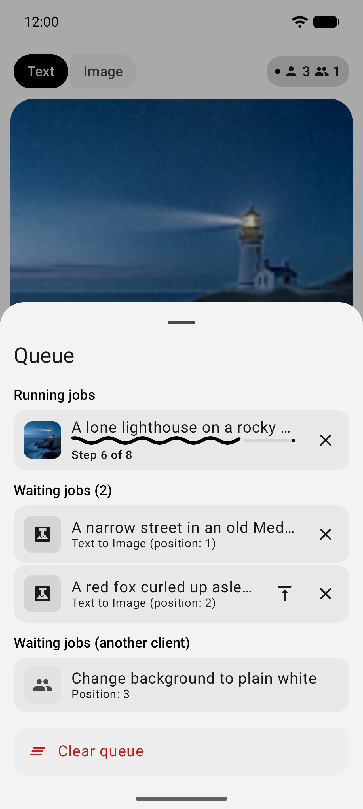
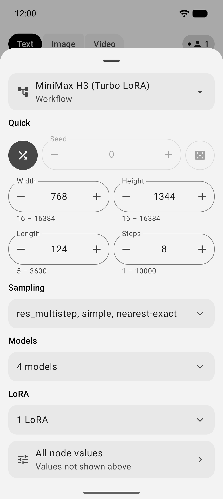
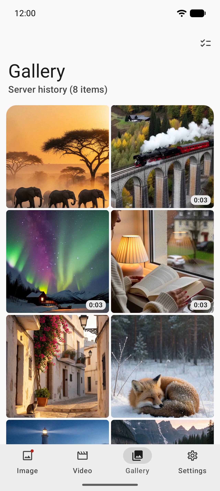
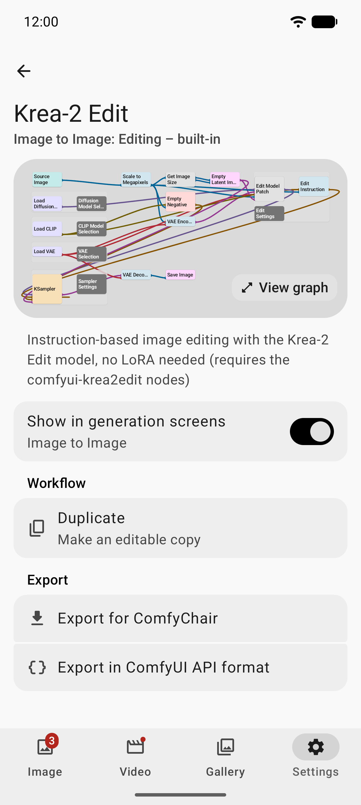
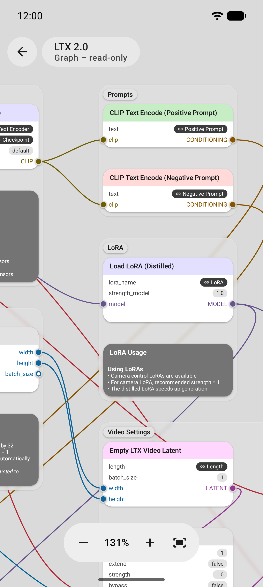

# Stable v0.8.26 / code63

[Download stable release](https://github.com/nickdlkk/comfychair/releases/tag/v0.8.26) · [Release notes and verification limits](docs/requirements/release-v0.8.26.md)

Combines beta.1–beta.8: immutable content-addressed upload reuse, unchanged Input reuse for native LoadImage, private persistent caching and cleanup/statistics settings, continuous Input/Output pagination, an independent server gallery, dedicated-key confirmed trusted-LAN deletion, compact fullscreen layout/scroll anchors, and original graphical loading/cancel feedback. The companion extension is disabled until separately configured by an administrator; HTTP is trusted-LAN only. Beta handoffs remain historical evidence, not current deployment instructions.

#  ComfyChair

## Independent gallery and optional extension (introduced in beta.5)
Standalone Settings server Input/Output gallery and separately installed physical deletion extension. The release ZIP defaults disabled until explicitly configured; existing deployments retain their private configuration. This publication does not change or restart a live server. [Requirements](docs/requirements/server-gallery-v0.8.26-beta.5.md) · [Installation and security limits](server/comfychair_media/README.md) · [Handoff](docs/requirements/server-gallery-handoff.md).


An unofficial, native Android UI for [ComfyUI](https://github.com/comfyanonymous/ComfyUI).

**Current stable**: [v0.8.26 / code63](https://github.com/nickdlkk/comfychair/releases/tag/v0.8.26) · [简体中文](README.zh-CN.md)

This fork's APKs are published in [nickdlkk/comfychair Releases](https://github.com/nickdlkk/comfychair/releases). The badges below link to the upstream project and F-Droid; they do not necessarily contain this fork's changes.

[](https://github.com/legal-hkr/comfychair/releases/latest)
[](https://f-droid.org/packages/sh.hnet.comfychair)

## Overview

ComfyChair provides a streamlined mobile interface for interacting with ComfyUI servers, allowing you to generate and manage AI images and videos directly from your Android device. The app communicates with your ComfyUI server via its API, bringing the power of node-based AI generation to your mobile workflow.

**Note**: This is an independent, community-developed project and is not officially affiliated with or endorsed by the ComfyUI team.

## Screenshots

       

## Features

### General

- **Multi-server support**: Save and manage multiple ComfyUI server connections with per-server settings and optional auto-login
- **Server connection**: Connect to remote or local ComfyUI servers with automatic HTTP/HTTPS detection and self-signed certificate support
- **Authentication**: HTTP Basic Auth and API key/Bearer token authentication for servers behind reverse proxies
- **Offline mode**: Browse cached data without network connection, with automatic offline prompt when server is unreachable
- **Queue management**: Submit multiple jobs without waiting, view queue count, cancel current job, add to front of queue, or clear queue entirely
- **Dual workflow support**:
  - **Checkpoint mode**: Traditional CheckpointLoaderSimple workflows
  - **UNET mode**: Modern diffusion workflows (Flux, Z-Image, etc.) with separate UNET, VAE, and CLIP model selection
- **LoRA chain support**:
  - Add up to 5 LoRAs per chain with individual strength control (0.0-2.0)
  - Text to Image and Image to Image: Separate LoRA chains for Checkpoint and UNET modes
  - Text to Video and Image to Video: Separate High Noise and Low Noise LoRA chains
  - LoRAs are dynamically injected into workflows at generation time
- **Prompt Library**:
  - Save prompts as reusable presets with custom names and tags
  - Organize presets with favorites and tag-based filtering
  - Quick access via dropdown or full library dialog
  - Search presets by name, prompt text, or tags
- **Localization**: Available in English (default), German, French, Polish, Spanish, and Chinese with per-app language selection
- **Native Android experience**: Built with Kotlin and Jetpack Compose with Material Design 3

### Generation Modes

- **Text to Image**:
  - Mobile-optimized interface with live progress updates
  - Live preview images during generation (when supported by server)
- **Image to Image**:
  - Two modes: **Editing** (transformation) and **Inpainting** (mask-based)
  - **Editing mode**: Transform images with optional reference images (up to 2)
  - **Inpainting mode**: Mask editor with adjustable brush size and feathered edges
  - Live progress updates and preview images during generation
- **Text to Video**:
  - Generate AI videos with High Noise / Low Noise UNET and LoRA model selection
  - Live preview during generation
- **Image to Video**:
  - Animate still images into videos with adjustable length and frame rate
  - High Noise / Low Noise UNET and LoRA model selection
  - Live preview during generation

### Input/Output infinite scroll fix (v0.8.26-beta.4)

Normal scrolling no longer stops after five automatic pages. Only five consecutive pages adding no distinct images pause auto-advance; the existing Load more action resumes. Viewport/cursor/loading updates are observed together, with appended-layout synchronization and single-flight controller guards; preview failures never block pagination and tiles retain explicit tap-to-retry. Persisted first-page lists and visible-only sampled thumbnails remain; later list pages still need network, with no stale cursor chain or eager full-image prefetch. See [requirements](docs/requirements/picker-scroll-v0.8.26-beta.4.md) and [verification](docs/requirements/picker-scroll-handoff.md).

### Configurable server-image cache cleanup (v0.8.26-beta.3)

Settings → Server image cache: automatic cleanup switch, 1–1024 MB limit and 1–365 day retention, saved to preferences and immediately applied to the live shared disk cache. Default ON / 64 MB / 7 days. Either age OR size triggers cleanup, oldest creation first (HMAC filename breaks timestamp ties); reads do not renew retention. Auto OFF retains the independent 1024 MB / 8192-entry safety ceiling. Freshness TTLs remain separate (24h lists/thumbnails; 7d descriptors); stale entries are misses, not retention deletions. No background timer: cleanup runs on reads/writes/settings apply. MB = MiB; entry-file bytes include 44-byte headers, not the 32-byte installation key.

Current cache size (formatted and exact bytes) and valid-entry count are scanned on IO when entering settings and after apply/clear; Refresh cache statistics captures later automatic cleanup. Counts/bytes exclude HMAC key, temporary files, unrelated files and corrupt entries; retained freshness-expired valid entries still count. Loading/error feedback is shown.

The separate manual button requires two clicks within 3 seconds, works with auto OFF, shows progress/result/error and clears only this feature across all server/account namespaces. It preserves the HMAC key, selected sources, materials, workflows and comparison snapshots; no server deletion. It closes the picker and clears memory fronts; pre-clear thumbnail/list/upload writes are generation-guarded. Uploads already in progress may finish but cannot repopulate cleared storage. See [requirements](docs/requirements/image-cache-cleanup-v0.8.26-beta.3.md).

### Persistent picker cache and Input reuse (v0.8.26-beta.2)

- Input/Output first-page lists appear from private disk before background refresh; query, sort, source, server and authentication are partitioned. Refresh retains the grid. Sampled thumbnails (at most 256px) persist across restarts; 24-hour disk TTL, configurable retention (default 64 MiB / 7 days), oldest-created eviction, checksum validation and atomic publication. Storage is app-private/no-backup, not encrypted media storage. Installation-random keyed HMAC namespaces never store raw credentials. Network previews still request full-resolution `webp;60`, bounded to 4 MiB: no invented server resizing.
- **Unchanged Input selections can skip upload entirely**, in Editing mode with every mapped consumer proven native `LoadImage.image`. Retained source object + Bitmap identity/mutation revision + authenticated client epoch must match; compression, masks, replacements, restored sources and custom nodes use encoded uploads. This explicitly uses original server-file semantics, not Android decode/re-encode equivalence. Read-only authenticated HEAD verifies existence: only 404 falls back to upload; auth/network/server/unsupported HEAD errors stop. Output direct reuse is not enabled.
- Encoded uploads remain immutable SHA-256 addresses (`overwrite=false`), single-flight and cancellable. Successful descriptors now persist for seven days in the same bounded private disk cache, with HEAD before reuse, plus 128 memory descriptors. Auth changes cannot reuse another namespace; returning to the same credentials/server can reuse disk entries. No server file deletion. Cache eviction/key loss/app-data removal causes safe misses.
- Existing active mapped slots/bypass, references, mask PNG, source snapshots, batch/front/confirmation flows remain. See [implementation and verification](docs/requirements/persistent-input-cache-v0.8.26-beta.2.md); previous beta evidence is historical.
- See [implementation/verification handoff](docs/requirements/image-upload-reuse-v0.8.26-beta.1.md). No on-device verification without adb hardware; see the stable release verification above.

### Server Input / Output source picker (v0.8.25)

- In **Image to Image**, use the cloud upload/download icons beside the existing file/material buttons to choose server Input or Output images for source slots 1–4. The captured target slot does not change when paging the source carousel. Existing local file, material library and gallery selection remain available.
- The compact material-style bottom sheet has a three-column image grid, a combined source/slot/count header, refresh/close/info actions, and one search/sort row. Asset-enabled servers provide debounced name search, cursor pagination and newest/oldest/name/size ordering. Counts distinguish displayed images from matching assets (which may include nonimages). Five sparse pages per automatic round are followed by explicit **Load more**.
- The existing authenticated connection probes `/api/features` and reads `/api/assets`. Only disabled/unsupported asset APIs fall back: Input uses the server's LoadImage options; Output uses paginated execution history, **not an output-directory scan**. Legacy mode has no server-side asset search/sort. Neither assets nor history promise a complete live filesystem view; deleted files and concurrent history deletion can require refresh. Authentication/network/server errors are shown, not disguised as empty lists or fallback.
- Visible thumbnails use at most three concurrent requests, 4 MiB encoded responses and sampled decoding to at most 256px. The owner-aware memory LRU is bounded to 12 MiB / 64 entries, fronting the private sampled-thumbnail disk cache described above. Choosing an image pauses new previews without clearing rendered thumbnails, list or scroll state; an overlay and cancellable indeterminate status indicate the original download (no invented percentage). Failed downloads retain the list and offer retry.
- Originals are fetched separately (asset-ID content for assets), limited to 32 MiB / 16,777,216 pixels; accepted images preserve original dimensions and replace only the captured slot. Server/client/slot/revision checks reject stale results. Closing, backgrounding, changing source or connection cancels work. Stable String grid keys avoid unsupported Android saved-state keys.

### Opt-in diagnostics

**Settings → Debug logging** retains the manual ZIP export/upload and adds separately enabled realtime diagnostic events. Debug capture and realtime upload are off by default; configure your own trusted endpoint ending exactly in `/events` (the separate ZIP endpoint may use `/upload`). Only value-free lifecycle/connection/picker events and sanitized fatal stack information are sent, without prompts, images, workflow contents, server addresses or ComfyUI credentials. HTTP is plaintext: use only on a trusted LAN, or use HTTPS. Upload runs only while an Activity is started, with bounded queues, batching, timeouts and retry backoff; disabling or changing the target cancels and clears pending uploads. A bounded private local journal is included in manual diagnostic ZIPs, but is not a complete persistent debug log. This helps investigate login-page returns; it does not prove every return was a crash.

### Release versus beta

`v0.8.25` is stable **versionCode 54**, newer than distributed `v0.8.25-beta.1` / 53. Release enables R8 code optimization/obfuscation and resource shrinking; debug remains unminified and usable for development. Explicit rules preserve reflective ViewModel/worker construction and diagnostics; dependency consumer rules cover framework/JNI integration. Diagnostic logging/realtime upload are **not stripped**. The locally published release retains the existing **Android Debug signing certificate** and application ID for upgrade compatibility; this is not newly provisioned production signing. Independently built CI APKs may use another debug certificate—do not assume they can update the local release.

Measured against beta.1 debug: **86,933,230 → 8,266,557 bytes (90.49% smaller)**; DEX **18 → 1**. The final build passed **94 JVM tests**, including explicitly enabled readonly live assets GETs. This compares debug with optimized Release, not an isolated shrinker-only A/B. Actual APK sizes and current validation evidence are recorded in the [release shrinking handoff](docs/requirements/release-v0.8.25-shrinking.md). JVM/live HTTP tests do not exercise optimized Android runtime code. Device installation, touch/rendering, Android bitmap/cache publication and release runtime remain unverified without an attached device.

### Editing dimensions and before/after comparison (v0.8.24)

1. Open **Image to Image → Editing**, select a workflow, and open its configuration. Width and height controls appear independently only when those fields are mapped in the workflow. Valid edits are saved per workflow and used for generation; unmapped dimensions remain controlled by the workflow. Saved values take priority over imported defaults, then the visible 1024 UI default. Invalid mapped dimensions block generation (current range: 1–4096).
2. Under **resolution presets**, choose **Same size as source image** to copy the primary source (slot 1)'s exact decoded pixel dimensions into the mapped fields, without rounding to multiples of 8 or 64. The preset is disabled without a primary image and hidden outside Editing or without dimension mappings. Out-of-range source dimensions are shown as validation errors, not silently resized.
3. After generation, open the result preview's **top-right Info** button. The panel shows the decoded result dimensions and **file size unavailable**: encoded response bytes are not retained, so bitmap memory size is not reported as file size. The **Original / result comparison** toggle is below this information.
4. Enable comparison, then drag the vertical divider left/right on the image or use the slider. Original is on the left, result on the right. Both fit the same full viewport before clipping; different aspect ratios retain letterboxing rather than stretching. Preview paging is disabled while comparing. Close comparison to restore tapping the result to open fullscreen.
5. In fullscreen, **press and hold with one stationary finger** to see the original; release or cancel to return to the result. Movement beyond touch slop, multitouch, leaving the page, or pausing the app also ends the comparison. Existing zoom/pan positioning is retained when temporarily showing the original.

**Availability:** Comparisons use the primary source snapshot captured when preparing that generation, associated with its server and prompt—not whichever source is selected now. They apply only to eligible Editing results, not gallery entries, source slots, videos, or unknown/restored history. Associations are session-dependent and snapshots live in the system cache; process restart, missing cache, or expired fullscreen capability tickets disable comparison. Comparison decoding may be downsampled (longest side at most 2048); the source-size preset uses the full decoded source dimensions. This is not permanent editing history.

**Workflow fixes:** Node-property edits now share raw/`nodes`/`prompt` handling, preserve connection arrays and Long precision. Editing raw prompts continue through finalization, bypass handling and debug snapshots. Only `SaveImageAdvanced` with explicit `format=png` receives missing/blank/null `format.bit_depth=8-bit` and `format.input_color_space=sRGB`; explicit values and unresolved placeholders are preserved. This does **not** claim to fix every Qwen 2.1 server validation error or infer missing model/sampler inputs.

**Validation:** Debug APK built successfully with 40 JVM tests passing (no failures, errors, or skips). Device touch gestures and live ComfyUI generation have not been verified; see the [validation handoff](docs/comfychair-qwen21-validation-handoff-2026-10-27.md).

### Media

- **Media viewer**:
  - Unified fullscreen viewer for images and videos
  - Material Design 3 Expressive UI with floating toolbar and FAB
  - Swipe navigation between gallery items with tonal navigation buttons
  - Pinch-to-zoom and double-tap to toggle between fit and crop zoom
  - Single-tap to toggle UI visibility (with system bars)
  - Quick actions: delete, save to gallery, share, view metadata
  - Metadata viewer showing generation parameters (prompt, model, seed, steps, etc.)
  - Optimized media caching for smooth transitions between items
- **Gallery**:
  - View all generated images and videos with 2-column grid layout
  - Video indicator on thumbnails
  - Pull-to-refresh to update gallery
  - Multi-select mode with dedicated button or long press to select items
  - Batch operations: save, share, or delete multiple items at once
- **Media management**: Save to device gallery (Pictures/ComfyChair or Movies/ComfyChair) or share

### Workflows

- **Full node graph visualization**: Colored nodes and connections matching ComfyUI's visual style with smooth Bezier curves or Hermite splines
- **Node management**:
  - Add nodes via searchable Node Browser with category filter chips
  - Human-readable display names shown where available (with class type as subtitle)
  - Deprecated and experimental nodes clearly marked with warning/science icons
  - Search by display name, class type, category, or description
  - Long-press output slots to open Node Browser filtered by compatible types
  - Delete, duplicate, bypass, and rename nodes
  - Cleanup tool to remove disconnected nodes
- **Node groups**:
  - Organize nodes into collapsible groups with grid layout
  - Rename groups via context menu
  - Groups persist across saves and theme changes
- **Connection management**:
  - Create connections by tapping an output socket and then an input socket (or vice versa)
  - Target sockets glow when compatible during connection creation
  - Delete connections via node context menu or by selecting and deleting
  - Selected nodes highlight connections with animated flowing segments
  - Connected slot circles enlarge and color-code when highlighted
- **Node attribute editing**:
  - Side sheet editor for node parameters (tap nodes to edit)
  - All editable inputs shown, including those using default values
  - Full support for both legacy and new ComfyUI COMBO input formats
  - Numeric steppers with floating labels, range hints, and increment/decrement buttons
  - Boolean values displayed as on/off toggles
  - Image previews for image selector fields
  - Template values highlighted with "UI:" prefix
  - Connected inputs styled with wire colors
  - Edited values highlighted for easy identification
- **Workflow notes**:
  - Add notes to workflows with Markdown support
  - Unified title and text editor
  - Notes displayed in the workflow graph
- **Navigation and zoom**:
  - Material Design 3 Expressive floating toolbar
  - Zoom controls with percentage display
  - Fit all / Fit width zoom options
  - Initial drawing animation when opening workflows
- **Workflow management**:
  - Create workflows from scratch or import existing ones from ComfyUI
  - Supported formats:
    - ComfyUI LiteGraph (import only) - native ComfyUI workflow format with subgraph support
    - ComfyUI API JSON (import/export) - workflow format used by the ComfyUI API
    - ComfyChair JSON (import/export) - preserves field mappings and app settings
  - Dynamic workflow thumbnails showing mini graph previews
  - Context menus for edit, rename, duplicate, export, and delete
  - Flexible field mapping: only Positive Prompt required (plus source image for image workflows)
  - Dynamic parameter constraints based on workflow node definitions
  - Per-workflow generation settings persistence
  - Workflow Editor returns to view mode after saving for continued editing

### Configuration

- **Server configuration**:
  - View detailed server information (ComfyUI version, OS, Python, PyTorch versions)
  - Monitor hardware resources (RAM and GPU VRAM usage with free/total display)
  - Server management actions (clear queue, clear history)
- **App management**:
  - Clear local cache (generated images, videos, source images, masks)
  - Restore default settings
  - Backup configuration to JSON file (connection settings, workflow values, custom workflows)
  - Restore configuration from backup
- **Workflow management**:
  - View and manage custom workflows with visual thumbnails
  - Upload custom ComfyUI workflows with automatic validation
  - Edit workflow name and description
  - Default generation settings extracted during workflow import
  - Per-workflow generation settings (each workflow remembers its own configuration)
- **Configuration persistence**: Automatically saves and restores all settings including prompts, models, workflow selections, and generation parameters on a per-workflow basis

## Requirements

- Android 13 (API level 33) or higher
- Access to a running ComfyUI server instance
- Network connectivity to reach your ComfyUI server

## Development setup

### Prerequisites

1. **Android Studio** (latest stable version recommended)
2. **JDK 17** (used by the Android Gradle plugin and CI)
3. **Android SDK** with API level 36

### Building the project

1. Clone the repository:
   ```bash
   git clone https://github.com/legal-hkr/comfychair.git
   cd comfychair
   ```

2. Set up your local environment:
   - Ensure `JAVA_HOME` is set to your JDK installation
   - Configure Android SDK path in `local.properties`

3. Build the app:
   ```bash
   ./gradlew assembleDebug
   ```

4. Run on device/emulator:
   ```bash
   ./gradlew installDebug
   ```

### Running tests

```bash
# Unit tests
./gradlew test

# Instrumented tests (requires device/emulator)
./gradlew connectedAndroidTest
```

## Configuration

To connect to your ComfyUI server, you'll need:
- ComfyUI server URL (e.g., `http(s)://192.168.1.100:8188`)
- Network access between your Android device and the ComfyUI server

## Tech stack

- **Language**: Kotlin 2.0.21
- **Min SDK**: Android 13 (API 33)
- **Target SDK**: Android 15 (API 36)
- **UI Framework**: Jetpack Compose with Material Design 3 (including Expressive components)
- **Video Playback**: Media3 ExoPlayer
- **Architecture**: MVVM with ViewModels and StateFlow
- **Navigation**: Jetpack Compose Navigation
- **Build system**: Gradle with Kotlin DSL

## Contributing

This project follows standard Android development practices:
- Kotlin coding conventions
- Jetpack Compose best practices
- Material Design 3 guidelines
- MVVM architecture pattern

## License

[GPL-3.0](https://www.gnu.org/licenses/gpl-3.0.en.html)

## Acknowledgments

- [ComfyUI](https://github.com/comfyanonymous/ComfyUI) - The powerful node-based UI this app interfaces with
- [Claude](https://claude.ai) by Anthropic - AI assistant that provided valuable support during the development process, helping with code implementation, architecture decisions, and documentation
